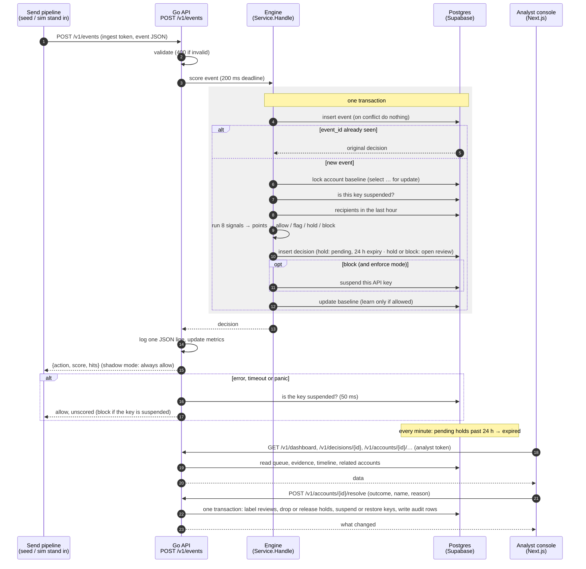

# Account Takeover Detection for Resend

A long-standing Resend customer is compromised and the attacker starts sending phishing from the customer's
verified domain. Reputation won't catch it: SPF, DKIM and DMARC all pass and the account's history is
spotless. This service notices that the account **has stopped behaving like itself**, tells a takeover
apart from a legitimate change, and stops the damage **without locking out the real owner**.

| | |
|---|---|
| Analyst UI | https://resend-ato.vercel.app (password shared in Slack) |
| API | `https://resend-ato-api.onrender.com` (`GET /healthz`; free tier, the first request may take ~1 min to wake) |
| Video | `TODO: Loom link` |
| Build spec | [SPEC.md](SPEC.md): event format, schema, every rule and endpoint |
| Deployment | [DEPLOYMENT.md](DEPLOYMENT.md), [web/README.md](web/README.md) |

**In one paragraph:** Resend's send pipeline would call `POST /v1/events` before it queues an email (an
assumption; here `cmd/seed` and `cmd/sim` play the pipeline). The service compares the event against a
per-account baseline using four signals (network, volume, content, account changes), adds up points, and
answers **allow, flag, hold or block** within a few milliseconds locally. On a hold the service records the
hold and its 24 h expiry; the pipeline is assumed to answer the caller with its normal "queued"
response, so the attacker gets no feedback, and to ask the owner out-of-band "was this you?" (the owner's
answer has an endpoint and a demo page here; the notification itself is not built). A block suspends
**that API key only**, not the account. Every decision is logged and stored with the signals that caused
it, and an analyst UI shows each account's timeline.

---

## 1. How the takeover happens

**Most likely vector: a leaked API key.** Resend is API-first. A key is a bearer credential that sits in
`.env` files, CI variables and server configs, far more exposed than the dashboard password, and the
dashboard's MFA doesn't protect it.

Grounded in Resend's docs ([API keys](https://resend.com/docs/api-reference/api-keys/create-api-key),
[SMTP](https://resend.com/docs/send-with-smtp), [API reference index](https://resend.com/docs/llms.txt)):

1. **Leak.** A `re_…` key ends up public: a committed `.env`, a `NEXT_PUBLIC_` variable shipped in a frontend
   bundle, CI logs, or a malicious npm/pip dependency that reads environment variables. The same key is also
   the SMTP password (username `resend`), so it sits in WordPress plugins and CMS configs too.
2. **Recon.** Keys are `full_access` or `sending_access` (optionally limited to one domain). With full access the
   attacker calls *List Domains* to find the verified sending domain, *List Contacts* / *Segments* to get the
   brand's real customer list, and *List Sent Emails* to copy the brand's real templates. Verified in my own account: with a full-access key, `GET /domains`,
   `/contacts` and `/emails` each return `200` with a list; with a sending-only key, each returns
   `401 restricted_api_key` ("This API key is restricted to only send emails"). Those failed reads
   are a signal too: a production key that suddenly tries recon has been picked up by someone else.
3. **Persistence (optional, full access).** *Create API key* so revoking the leaked one doesn't help, or
   *Update Webhook* so bounce and complaint events stop reaching the owner. Team invites have no API, so that
   step needs a dashboard takeover (see other vectors).
4. **Exploitation.** *Send Email* / *Send Batch Emails* from the brand's verified domain: "your payment failed,
   update your card" linking to a lookalike or newly registered domain, or a link-free "reply to confirm the
   bank details" with **Reply-To** pointing at the attacker (business email compromise).
5. **Evasion.** Residential proxies or the same cloud as the customer, a copied User-Agent, slow sending under
   the 10 req/s team rate limit, copied templates, links through shorteners or file-sharing sites.

**The key insight:** the key is old but the context is new. A key proves someone *holds* it, not who they are.
The attacker reuses a trusted credential but brings a new network, new link and reply domains, and new
account activity. Those are what the system looks for.

**How this system catches each step:** recon → `first_read` (first-ever read of contacts, audiences or domains);
persistence → `recent_account_change`; the send → `new_asn` plus the content signals; volume → `recipient_spike`.
The phishing email itself is held before it is queued (given the pipeline integration assumed below).

### Other vectors

| Vector | What catches it | What it evades |
|---|---|---|
| Leaked API key (main) | network, content, account changes | - |
| Leaked SMTP credentials (plugins, CMS configs) | same as above; a protocol switch from HTTP to SMTP would be a cheap extra signal (not scored yet) | client fingerprint |
| Dashboard login takeover (phished password, no MFA) | new key created and used within minutes, broadcast to the whole list | API-only signals until a key is used |
| OAuth app or remote MCP server grant ([OAuth](https://resend.com/changelog/oauth-support), [MCP](https://resend.com/docs/mcp-server)): a consent-phished or prompt-injected AI agent with `full_access` | content, account changes | network (the app's own servers) |
| Compromised customer server / supply chain | **content only** | network and client: they really are the customer's. **The hard case.** |
| Abuse through the customer's app (contact form injecting links) | link domains in user-controlled fields | everything except content |
| Webhook redirection | webhook change shortly before the anomaly | the owner's own alerting |
| Data theft, no sending | a first-ever contacts read (`first_read`), from a new network (`new_asn`) | every sending signal |

---

## 2. Signals: what's collected and why

Everything comes from the request. This is API-to-API traffic: no browser, no device, no session, no CAPTCHA.
The upside is that servers are very stable, so deviations stand out more than they do for human logins.

| # | Signal | Question | Needs history? | Attacker's cost to evade |
|---|---|---|---|---|
| 1 | **Network** `new_asn` | Is this key sending from an ASN it has never used? | yes | Must rent infrastructure in the victim's cloud |
| 2 | **Volume** `recipient_spike` | Recipients in the last hour > 3× this account's normal? | yes | Send slowly, which caps the damage |
| 3 | **Content** `new_domain`, `young_domain`, `lookalike_domain`, `freemail_reply_to` | Do links, Reply-To or addresses in the body point somewhere new, newly registered, or brand-like? | young and lookalike: **no** | Must use an aged domain the account already links to |
| 4 | **Account changes** `recent_account_change`, `first_read` | Any account change (key created or deleted, team member added, webhook or domain change) in the last 24 h? First-ever read of contacts, audiences or domains in the last 24 h? | **no** | Skip persistence and recon, which makes the takeover blinder |

**Content is the strongest signal.** The one thing an attacker can't fake is the *purpose* of the email: a
phishing email has to send the victim somewhere, a link or a reply address. One domain-risk check is applied to
link domains, Reply-To domains (from `reply_to` **and** any custom `Reply-To` header) and email addresses in
the body, so link-free BEC doesn't slip past a links-only check. Domains are compared by registrable domain
(`app.acme.com` = `acme.com`). A lookalike imitates the sender's domain or another domain the account sends
from: a 1–2 character typo (`acrne.com`), the same name on another suffix (`acme.co`), or a name containing
the brand (`acme-secure.com`), for names of 4+ characters; domains the account already uses are never
lookalikes.

**Clean-history accounts:** `young_domain`, `lookalike_domain` and `recent_account_change` need no history, so
they work from the first event (`first_read` waits until an account is 7 days old, because during onboarding
every read is a first read). Signals that do need history (`new_asn`, `recipient_spike`, `new_domain`,
`freemail_reply_to`) stay quiet until an account has 50 allowed (or analyst-approved) events;
`recipient_spike` also waits for 24 active sending hours.

Design choices worth calling out:
- **ASN per key, not raw IP:** cloud IPs change constantly; the ASN doesn't. A new key on an old account is
  compared with the whole account's networks until it has 20 allowed events of its own.
- **Recipients, not requests:** batch, CC and BCC put many recipients into one request.
- **Velocity is the weakest signal by design,** because a real campaign looks identical. It can never act alone.
- **Privacy:** bodies, subjects and recipient addresses are parsed in memory and dropped. From an email only
  domains (sender, link, Reply-To, body addresses) and the recipient count are stored, next to the request's
  IP, ASN and User-Agent; the decision log line carries ids, action, score and signal names, not content.

**Collected but not scored yet:** User-Agent (stored on every event; easy to copy, so supporting evidence
only) and the source (`api`, `smtp`, `dashboard`). **What I'd add in production (not built):** TLS
fingerprint (JA3/JA4, needs TLS termination at Resend's edge), payload shape (which
optional fields and headers a key always sends; harder to fake than a User-Agent), recipient overlap with
past recipients, template similarity, protocol switch (HTTP → SMTP), live RDAP domain age, phishing feeds, and
**outcome signals** (bounce and complaint spikes from webhooks): too slow to stop the first email, but a second
detection layer and the source of ground-truth labels.

---

## 3. Takeover or legitimate change?

Every legitimate change trips *some* signal: a cloud migration is a new network, a campaign is a volume spike,
a new partner is a new link domain. A takeover usually trips several **independent** signals at once. So the
model is simple points, chosen because every number can be explained:

| Signal | Points | Why this weight |
|---|---|---|
| `new_asn` | 30 | strong, but real migrations happen |
| `recipient_spike` | 15 | weakest: campaigns look the same |
| `new_domain` | 25 | the attacker needs their own link or reply address |
| `young_domain` (< 30 days) | 20 | phishing domains are usually brand new |
| `lookalike_domain` | 30 | almost never legitimate |
| `freemail_reply_to` (first time) | 15 | businesses rarely route replies to personal mailboxes |
| `recent_account_change` | 20 | persistence |
| `first_read` | 20 | recon |

| Score | Action |
|---|---|
| 0–29 | **allow** |
| 30–59 | **flag**: logged on the account timeline; email still sent, no review |
| 60–79 | **hold**: not sent (the pipeline keeps it); opens a review; owner asked out-of-band (assumed) |
| 80+ **and** ≥ 2 signal categories | **block**: suspend the key (an event without a key, e.g. from the dashboard, is held instead) |

**The rule in one sentence: one signal on its own can at most flag; signals agreeing can hold or block.**
The exception is content, which can reach hold alone, because a young lookalike link is phishing by
definition, but even content can never block on its own.

| Scenario | Score | Action |
|---|---|---|
| Normal send | 0 | allow |
| Marketing campaign (spike only) | 15 | allow |
| Cloud migration (new network only) | 30 | flag |
| New key created, then used from the usual network | 20 | allow |
| Takeover: new network + new young link domain | 75 | hold |
| Same, plus a volume spike | 90 | block |
| Clean-history account, young lookalike link | 50 | flag |

How legitimate owners get through, and how the attacker doesn't get to train the system:
- **Hold, don't reject.** The service answers `hold`; the pipeline is assumed to show the caller a normal
  queued response. The owner answers "this was me" (releases the email, teaches the baseline) or "not me"
  (suspends the key) through `POST /v1/holds/{id}/owner-response`, which the UI's `/hold/{id}` page
  demonstrates. In this demo both sit behind the analyst login and token; in production the owner would get
  a signed link by account email or in the dashboard, never through the sending API (not built). A wrong
  hold costs a real owner one click.
- **Block the key, not the account.** Other keys keep working.
- **Compare first, then update.** The baseline is read before the event is learned, so an attacker's first
  event can never be "normal".
- **Only allowed events teach the baseline.** Flagged, held and blocked events never do. An analyst's
  "mark legitimate" (or the owner's "this was me") teaches it instead. Account changes and first reads are
  recorded either way, so getting held doesn't hide them.
- **Thresholds by cost:** flag is set by analyst capacity; hold is cheap for owners, so it accepts lower
  precision; block is expensive when wrong, so it needs a high score *and* two categories. All points and
  thresholds live in [config.yaml](config.yaml), and the config version is stored on every decision.
- **Check the infrastructure across accounts.** Attackers reuse phishing domains and servers, so each decision
  page lists other accounts that used the same link domain, Reply-To domain (free-mail domains excluded) or
  IP within 7 days either side of the event, and how many were held, blocked or confirmed as takeovers
  (counts cover every account; the 50 most severe are listed, the UI shows five and expands). A match with a
  confirmed takeover settles the call; a domain seen on many accounts with no stops points to shared,
  legitimate infrastructure. ASNs and body-address domains are left out; a cloud ASN is shared by thousands
  of legitimate senders. The engine doesn't score this yet (see section 6).

  **Cost at scale.** The lookup runs only when an analyst opens a decision, never while scoring, so send
  volume doesn't slow the hot path; each page view pays instead, in proportion to how many events share the
  indicator. Measured locally after the simulator run in section 4 (82,809 events), the whole
  `GET /v1/decisions/{id}` round trip takes a median 23 ms for a send linking the attacker's
  `invoice-portal.net` (178 events on 9 other accounts in the window, plus its IP on 28 accounts) and 41 ms for
  one linking `notion.so` (2,451 events on 128 accounts, plus a shared Azure IP on 65). At Resend's volume a
  popular domain or shared egress IP would match millions of events, and the answer ("on 40,000 accounts")
  carries no signal anyway. What I'd change, in order (none of it built): (1) stop counting at ~500 accounts
  and show "common, ignored"; (2) a rollup table of indicator × account × day with the worst action, written
  at scoring time, so cost follows the number of accounts sharing an indicator rather than the events they
  sent; (3) partition events by day, so a ±7 day window reads 15 partitions; (4) at full scale, a columnar
  store with a materialized view (section 5).

---

## 4. Measuring whether it works

**Production plan:** run new rules in **shadow mode** first (score and log, always allow), then measure:
- **Precision:** analyst "confirm takeover" / "mark legitimate" labels and owner "not me" / "this was me"
  answers, per action and per signal.
- **False positives:** false holds and blocks per 1,000 active accounts, plus the rate of owners answering
  "this was me".
- **Time to detection:** attacker emails delivered before the first hold or block.
- **Missed takeovers:** complaint and bounce spikes on *allowed* mail, which is how a miss eventually shows up.

**Offline: the simulator.** `make sim` generates labeled accounts, posts them in time order to a running
server, and scores every decision. The run below is a local run of `make sim ARGS="-accounts 300"` on
2026-11-03 (Postgres 16 on the same machine): 300 accounts, 82,809 events in 43 s, ~70% with 30–45 days of
history and ~30% only 2–4 days old (cold start). Each account gets one scenario: normal, one of seven legitimate
changes, or one of nine takeovers (40% takeovers, far above real life, to get enough examples).

| Result | With history | New accounts |
|---|---|---|
| Takeover types fully stopped (every account held or blocked) | 5 of 9 | 0 of 4 |
| Attacker emails delivered when a takeover was stopped | **0** (the first email is held) | n/a |
| False holds or blocks on legitimate accounts | **0** of 115 accounts | **0** of 59 accounts |
| Precision at ≥ hold / ≥ block (attacker events) | 100% / 100% | n/a |
| Recall at ≥ flag / ≥ hold (attacker events) | 84% / 70% | 22% / 0% |
| Legitimate accounts flagged (email still sent) | 400 per 1,000 (46 of 115) | 0 |

An earlier run of the same simulator against the hosted service on Oct 30 (Render free tier and Supabase;
100 accounts, 29,317 events, 13 minutes) gave the same picture: precision 100% at ≥ hold and ≥ block, 0 false
holds or blocks, recall 76% at ≥ hold for accounts with history, and server scoring p50 19 ms, p95 22 ms.
The hosted database has since been reset for the demo, so it doesn't contain those events.

Per takeover type (accounts with history):

| Takeover | Outcome |
|---|---|
| Fast or slow, from a new network, young link | stopped, 0 emails delivered |
| Link-free BEC (gmail Reply-To) from a new network | stopped |
| Recon → new key → send | stopped (the recon read is flagged first) |
| Brand lookalike link | blocked |
| Same cloud as the owner, young link or gmail Reply-To | **flagged only**: emails delivered |
| Compromised server (aged phishing domain) / link via a domain the account already uses | **missed** |

What the numbers say:
- **Hold and block were never wrong** in this run, and when they fired the attacker's first email was already held.
- **Flags come from deliberate changes,** not normal traffic (normal accounts: 0%). Every cloud migration is
  flagged, by design. Flags are logged and charted but don't open a review; only hold and block (which stop
  mail) go to the analyst queue, so a lone new network doesn't page anyone. The rate is inflated by a scenario mix that is
  mostly accounts making changes.
- **Per-signal precision** matches the weights: `young_domain` and `lookalike_domain` 100%, `first_read` 98%,
  `new_asn` and `new_domain` 89%, `freemail_reply_to` 75%, `recent_account_change` 43%, `recipient_spike` 24%.
- **Cost of suspending keys:** 200 owner emails on 31 accounts were blocked because the key was suspended. Hence
  "block the key, not the account", plus the owner and analyst restore flows.
- **New accounts are the weak spot:** with no history, a young link alone scores 20 (allow). Raising
  `young_domain` to 35 would flag these and hold the same-cloud attacker, at the price of holding owners who
  link to their own brand-new domain. That is the kind of trade-off the simulator exists to test.

Synthetic data validates the logic, not real-world accuracy. In production the weights would be calibrated
against complaint-confirmed takeovers and analyst labels.

---

## 5. Architecture and reliability

```
Resend send pipeline ──POST /v1/events──▶ Go service ──▶ Postgres (Supabase)
  (simulated by cmd/seed, cmd/sim)          │ one transaction:            ▲
                                            │  save event (idempotent)    │
                                            │  lock account profile       │
                                            │  run 4 signals → points     │
                                            │  save decision, act on key  │
                                            │  update baseline            │
                                            └─▶ {action, score, hits}     │
                                                                          │
Analyst UI (Next.js) ──server-side, analyst token──▶ analyst API ─────────┘
```

### One event, step by step



- **Inline, before queueing.** You can only hold an email that hasn't gone out; delivered phishing can't be
  recalled. Scoring takes about 9 database round trips. Locally (Postgres on the same machine) `make seed`
  measured server-side scoring at p50 0.6 ms / p95 0.8 ms (HTTP round trip p50 1.4 ms) one event at a time,
  and the simulator's 8 parallel workers saw p50 2.4 ms / p95 3.8 ms. So the database should sit in the
  same region as the service.
- **Fail open.** If scoring fails (a database error, a panic in a signal, or missing the 200 ms
  `scoring.timeout_ms` deadline), the answer is `allow` with `unscored: true`, the error is logged and
  `ato_unscored_total{reason}` counts it. A detector outage must not stop every customer's email. One
  exception: a separate 50 ms lookup still answers `block` (`key_suspended`) for a key that is already
  suspended. In the Oct 30 hosted run this happened to 2 of the first ~600 simulator events under parallel
  load (p99 27 ms, but rare spikes passed 200 ms); the simulator now resends unscored events and reports
  how many.
- **Shadow mode** (`ATO_MODE=shadow`): compute and store real decisions, always answer allow, never hold or
  suspend; the config version gets a `.mode-shadow` suffix. A key that is already suspended stays blocked,
  because that was an analyst's or owner's decision, not a rule under test. Used to roll out new rules
  safely. The hosted demo runs in enforce mode because its traffic is all synthetic, so holds and key
  suspensions show up; a real rollout would start in shadow.
- **Atomic and idempotent.** One transaction per event; a repeated `event_id` returns the original decision.
  The account's profile row is locked, so concurrent events on one account can't lose baseline updates.
- **Graduated, reversible actions.** Holds expire after 24 h (a ticker marks them expired every minute); a
  suspended key stays suspended until someone restores it. Every analyst action needs a name and a reason
  and is audited.
- **One incident, not a review per rejected send.** Once a key is suspended, every later send on it is
  rejected (`key_suspended`) without opening a review: the suspension and the decision that caused it are
  the case. The queue ranks those rejections below the decision that caused them.
- **Expired holds are dropped, not sent** (`hold.expire_action: drop`, an instruction to the send pipeline;
  this service only marks the hold expired and keeps the review open). A held email that nobody vouched for
  in 24 h is more likely phishing than urgent, and a phishing email delivered a day late still does harm.
  The cost is a legitimate email lost when the owner doesn't answer, so the owner should be told it failed
  (pipeline side, not built), and the setting can be `release` instead. A better policy (not built): drop
  only while the account has another open review or a suspended key, otherwise release.
- **Signals are a slice of functions (`signal.All`),** each returning hits with a name, category and
  points, so adding one doesn't touch the engine. They run sequentially because each is a microsecond
  in-memory check; concurrency is across requests.

### The analyst's path

The engine contains the damage in milliseconds; a person makes the final call, **per account, not per
email**. An analyst asks "is this account taken over?", so that is the one question the UI asks.

| Page | Its one job |
|---|---|
| Queue (`/`) | What needs attention: accounts to review, held emails (with time left), suspended keys. A row opens the account. |
| Decision (`/decisions/{id}`) | Evidence for one email: the score, each signal's evidence, the same infrastructure on other accounts. It states the incident the email belongs to and its deadline, and links to the account to decide. |
| Account (`/accounts/{id}`) | **The only place to decide.** Timeline charts, the baseline, the keys, and the incident. |

On the account page:
- **Resolve account** (`POST /v1/accounts/{id}/resolve`) closes every open review with one outcome, in one
  transaction. *Takeover* labels them, drops their held emails, and suspends the keys they were sent with
  on the analyst's authority (including keys the engine already suspended), dropping any other held email
  on those keys. *Legitimate* labels them, teaches the baseline from each stopped email and releases the
  held ones. Before submitting, the form lists what it will and won't change and names the button after it
  ("Resolve 3 reviews as takeover"). The incident panel leads with the one time limit: "Decide by 14:05: the
  held email is dropped automatically then" (the hold's expiry; the drop itself is the pipeline's job). The
  request names the reviews the analyst saw; if a new one arrived (the attacker's next send), nothing
  changes and the analyst reloads.
- **Restoring a key is a separate step**, because a wrong restore lets an attacker send again. Resolving as
  legitimate offers an unticked box for keys the engine suspended for these reviews (or for a decision
  already marked legitimate); otherwise the success message names the key left and links to its restore.
- **Friction only where a mistake is expensive.** Calling *legitimate* over attacker-looking evidence (young or
  lookalike domain, recipient spike, freemail Reply-To), restoring a key stopped for that evidence, or
  restoring one after a confirmed takeover needs the account ID typed. The API enforces it, not just the UI.
  An owner's "this was me" on their own hold needs no confirmation.
- **Wrong calls can be taken back.** *Correct to takeover* (`POST /v1/accounts/{id}/correct`) relabels
  chosen decisions marked *legitimate* as takeover, removes those events from the baseline (network, domains,
  event count; not the recipient average, sender domains or the free-mail Reply-To flag), suspends the keys
  they were sent with and drops those keys' held emails. Released emails stay sent; the audit log says who
  corrected what. A key can also be suspended by hand from its key line (`POST /v1/keys/{id}/suspend`).

### What I'd build next

- **A stored case object.** Today the incident is "everything open on the account". A case table would group
  the trigger, its rejections and the holds from the same window, give each its own history, and let an
  analyst resolve one of several incidents on an account.
- **Mixed incidents.** When some stopped emails were the owner's, the analyst resolves the account as a
  takeover and the owner resends. Per-email exceptions inside a case would fix that; the API already has
  per-decision actions (`POST /v1/decisions/{id}/actions`) and the owner's per-hold answer
  (`/v1/holds/{id}/owner-response`), so it's a UI and case-model change.
- **Urgent single release** of one held email, for the same reason.
- **Revoke keys created during the incident.** A key created after the first stopped email is attacker
  persistence. Today the account page lists it even before it sends ("no allowed sends yet") and the
  analyst suspends it by hand; resolving as takeover should suspend it too.
- **Restore after takeover needs the owner to rotate the key,** not an analyst click.
- **A rolling per-account score.** Each email is scored on its own, so an attacker's first, quiet emails go
  out and an account crosses the line only when one email does. Scoring a window of sends would catch slow
  attacks earlier.

**Observability:** one structured JSON log line per decision (event, account, key, event type, action,
enforced, score, signal names, config version, latency), and every decision is stored with its signals for
audit and stats. Aggregated stats (totals, decisions over time, top signals, review queue) are served by
`GET /v1/stats`; the UI charts them.
`GET /metrics` (analyst token) exposes Prometheus metrics for operating the service:
`ato_decisions_total{action,enforced}`, `ato_signal_hits_total{name}`, `ato_scoring_latency_seconds`,
`ato_unscored_total{reason}` (error, timeout or panic), `ato_key_suspensions_total{reason}` (who suspended the key:
auto, analyst or owner) and `ato_holds_pending` (set by the hold ticker). Labels are bounded (never account
or key ids), in the text format any Prometheus-compatible scraper reads; `make prom-up` starts a local
Prometheus with a scrape config (`prometheus/prometheus.yml`) and no alert rules. Alerts I'd add (none are
defined in the repo): unscored rate above zero (detection is silently off), p99 latency near the 200 ms
deadline, and a jump in `ato_key_suspensions_total{reason="auto"}` per hour (a bad rule mass-suspending
keys).

**Production version** (not built, on purpose): Temporal for the hold lifecycle (notify, wait, escalate,
release or revoke), per-account sharded workers with an in-memory profile cache, Kafka and a columnar store
for events at Resend's scale, and a circuit breaker capping automatic key suspensions per hour so a bad rule
can't mass-suspend.

---

## 6. Known loopholes

An attacker who does **all** of these scores near zero:

- sends from the customer's own cloud provider → network 0
- sends slowly → volume 0
- uses an aged or compromised domain → young domain 0
- creates nothing and reads nothing → account changes 0
- links through a domain the account already uses (shortener, Google Docs, Dropbox) → new domain 0

Partial misses, also in the simulator (section 4), each with the signal that would close it:

| Case | Today | Why | Next signal |
|---|---|---|---|
| Attacker on the owner's cloud with a young link or gmail Reply-To | flag only, mail delivered | network scores 0; a new young link scores 45 (`new_domain` 25 + `young_domain` 20) and a new gmail Reply-To 40 (`new_domain` 25 + `freemail_reply_to` 15), below hold (60) | IP /24 or cloud region inside the ASN |
| Takeover of an account with no history, sending a young link | allowed (score 20) | history signals stay quiet below 50 events, so only content can fire | `young_domain` at 35 (trade-off in section 4), account-age prior |
| Link through a domain the account already uses | missed | `new_domain` checks the link host, not where it redirects | follow redirects and file-sharing links to the final host |

These are the price of zero false holds and blocks in the simulation: each fix moves some legitimate
changes from flag to hold.

The simulator confirms these misses. Mitigations: finer network detail (IP /24, cloud region), looking
through shorteners and file-sharing links, recipient behavior (whole list at once vs one-to-one
transactional), TLS and payload fingerprints, and outcome signals as a second layer.

**Future work:** a cross-account signal (points when an event's link domain or IP was already confirmed as a
takeover on another account), which the decision page already shows analysts; per-account weights (a new network matters less for a key that changes networks often); a
log-odds model, `risk = sigmoid(prior + Σ ln(P(obs | takeover) / P(obs | normal)))`, where the prior encodes how
rare takeovers are and makes "two signals needed" fall out of the math; and learning the weights with logistic
regression from analyst labels.

---

## 7. Try it

Requirements: Go 1.26+, Docker, Node 22+ (UI only).

```sh
cp .env.example .env
make db-reset        # Postgres in Docker + schema
make run             # API on :8080
make seed            # in another terminal: scripted demo, checks every decision
make sim             # detection-quality report (200 accounts by default; 300 took 43 s locally)
make test            # unit + database integration tests
make e2e             # full-stack browser scenarios: real UI + API + Postgres (~1 min with the build)
make prom-up         # optional: Prometheus UI on :9090, scraping the API's /metrics
```

`make seed` posts 597 events and checks every decision: 60 days of normal history for `acc_acme` (all
allow, including a campaign hour that trips `recipient_spike`), a young lookalike link on the clean-history
`acc_beta` (**flag 50**), then a takeover of `acc_acme` from a new network with a young link: **hold 75**,
then **block 90** once the volume spikes, after which every send is rejected as `key_suspended`. For the UI,
see [web/README.md](web/README.md).

Send one event to a brand-new account (only the history-free signals can fire):

```sh
curl -s localhost:8080/v1/events -H "Authorization: Bearer $INGEST_TOKEN" -d '{
  "event_id": "evt_1", "type": "email.send", "occurred_at": "2026-10-30T14:02:11Z",
  "account_id": "acc_demo", "api_key_id": "key_demo_1", "source": "api",
  "network": {"ip": "203.0.113.9", "asn": 14061, "asn_org": "DIGITALOCEAN-ASN"},
  "email": {"from": "Acme <billing@acme.com>", "to": ["a@example.org"],
            "html": "<a href=\"https://acme-secure.com/pay\">Pay</a>"}}'
```

```json
{"event_id": "evt_1", "decision_id": "164f8282-…", "action": "flag", "enforced": true, "score": 30,
 "hits": [{"name": "lookalike_domain", "category": "content", "points": 30,
           "detail": "acme-secure.com looks like acme.com"}],
 "reason": null, "unscored": false, "config_version": "2026-10-30.1", "latency_us": 989}
```

Event types are `email.send`, `account.change` and `api.read`. Full formats, the schema and every analyst
endpoint are in [SPEC.md](SPEC.md).

**Assumptions:** Resend's pipeline calls this service before queuing and obeys the answer; it enriches events
with ASN data; on hold or block it still returns "queued" to the caller; owner notification happens
out-of-band, and it drops or releases expired holds as `hold.expire_action` says. Domain age comes from a
config table (`content.domain_ages`) standing in for live RDAP lookups; an entry is a date or an age
relative to when the service started (`4d`), so the seed and simulator keep working on any date.

---

## Repository

```
cmd/server     HTTP service, hold ticker      internal/event    event parsing, feature extraction
cmd/migrate    schema migrations              internal/profile  per-account baseline
cmd/seed       scripted demo with checks      internal/signal   the four signals
cmd/sim        quality simulator + report     internal/engine   scoring, decisions, analyst actions
web/           analyst UI (Next.js)           internal/action   allow/flag/hold/block ordering
migrations/    SQL schema                     internal/store    Postgres
prometheus/    local scrape config            internal/api      HTTP handlers
scripts/       full-stack test API runner     internal/config   config.yaml loading and validation
config.yaml    points, thresholds, windows    internal/metrics  Prometheus collectors
```
